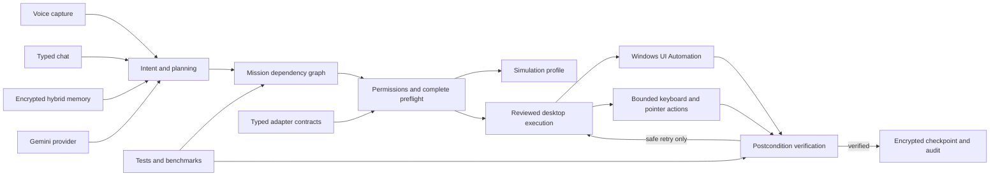
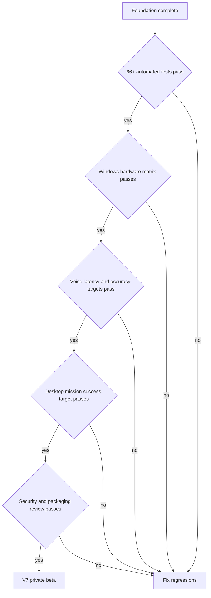

# JARVIS V7 product map

This is the evidence-based route from the current V6 application to a product
that can compete with established desktop assistants. A feature is only marked
ready when it has an implementation and a check that can fail.

## Five product pillars

1. **Extensible foundation:** every new feature must enter through typed,
   permission-aware contracts and remain measurable, replaceable and testable.
2. **Gemini registration:** setup is the first AI experience. It must explain,
   validate, test, store and recover credentials without exposing them.
3. **Desktop control:** natural requests become reviewed bounded missions with
   complete preflight, approvals, checkpoints and observable results.
4. **Fast intelligence:** local replies handle instant work while Gemini routes
   between fast chat, grounded research and reflection according to the request.
5. **Responsive customizable voice:** users choose voice, style, speed, pitch,
   volume, microphone, language and end-of-speech timing. Latency is measured.

## Product architecture

## Current revision

| Area | Current state | Evidence | V7 requirement |
|---|---|---|---|
| Chat intelligence | Gemini chat, reflection, grounded research and local fast replies | Provider and request tests | Add an evaluation set for answer quality and citation accuracy |
| Voice input | Adaptive VAD, multilingual free recognition and Gemini audio option | Speech and capture tests | Stream partial transcripts, measure word error rate on real microphones, add echo cancellation |
| Voice output | Multilingual Edge neural voices with cached short replies | Speech formatting tests | Sentence streaming, interruption during playback and a licensed premium voice option |
| Desktop control | 18 allowlisted actions, UI Automation, plan review and emergency stop | Action, planner and permission tests | Broader app adapters, visual fallback and Windows hardware acceptance runs |
| Execution reliability | Full-plan preflight, dependency graph, encrypted checkpoints and bounded safe retries | Reliability tests and benchmark runner | Resume UI for interrupted missions and richer app-specific postconditions |
| Result verification | Clipboard, pointer, screenshot, focused window, field text and window layout checks | Positive and negative verifier tests | Add visual change checks and confirmation contracts for every mutable action |
| Memory | Encrypted categories, scoped conversations, lexical plus local related-memory ranking | Memory, encryption and Unicode tests | User-visible links, summaries, conflict detection and optional local embeddings |
| Plugins | Declarative manifests, typed operations, exact domains, permissions and SHA-256 payload integrity | Manifest and adapter contract tests | Signed packages, lifecycle manager and first production calendar/task adapter |
| Isolation | Reviewed host mode and a real no-execution simulation mode | Dry-run test | Connect Windows Sandbox or a disposable VM before claiming isolated execution |
| Providers | Typed capability catalogue with Gemini active | Provider routing tests | Add optional provider adapters only after secret, cost and capability controls exist |
| UI | Five presence designs, six themes, capabilities, diagnostics, performance and Mission Control | Offscreen UI smoke test | Reduce settings density, add mission graph/recovery view, benchmark history and first-run tour |
| Security | Credential Manager, encrypted local records, allowlists and backend approvals | Secret rejection, crypto and permission tests | Threat model, dependency scanning, signed releases and independent review |
| Packaging | Windows installer and GitHub Actions workflow | Workflow definition | Test clean Windows 11 install, update, rollback, uninstall and shortcut creation |

## Release gates

Suggested private-beta targets:

- 95% success on 50 repeatable low-risk Windows missions.
- 100% approval enforcement for sensitive actions.
- 0 invented action-success reports; every result is `verified`, `reported`, or `failed`.
- Median local command response below 150 ms.
- Median end-of-speech to visible transcript below 700 ms on the target computer.
- No plaintext keys, memory records, checkpoints, or conversation content on disk.
- Clean install, upgrade, rollback, uninstall and shortcut tests on Windows 11.

## Recommended V7 sequence

1. **V7.0 reliability beta:** interrupted-mission recovery UI, Windows acceptance
   runner, benchmark history and complete verification labels.
2. **V7.1 voice:** streaming transcription state, sentence-level speech playback,
   barge-in and real-device latency/accuracy measurements.
3. **V7.2 app intelligence:** typed adapters for browser research, calendar,
   tasks and email drafts. Sending remains approval-gated.
4. **V7.3 safe expansion:** signed plugin packages, optional MCP client with an
   explicit server allowlist, and connected Windows Sandbox execution.
5. **V7 stable:** signed installer, automatic rollback, privacy export/delete,
   documentation, threat model and external beta evidence.

The application should remain private until the Windows acceptance matrix and
security review pass. Passing local unit tests is necessary evidence, but it is
not proof that the product is better than paid or open-source alternatives.
